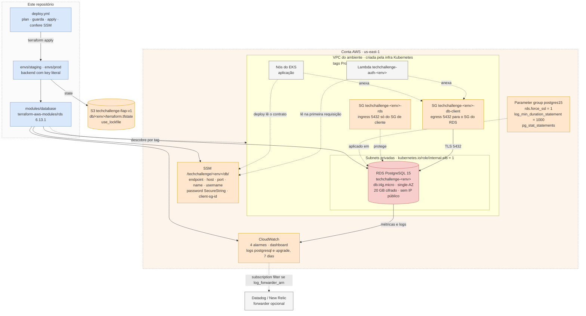
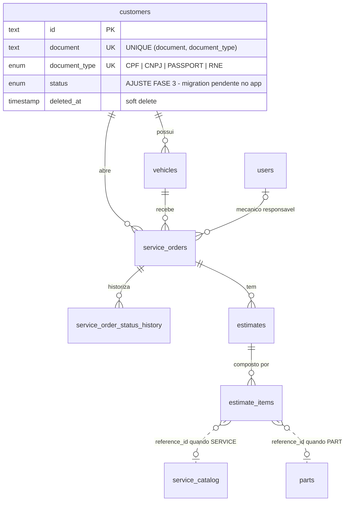

# Infraestrutura do Banco de Dados Gerenciado — Tech Challenge Fase 3

Provisiona, por Terraform, o **PostgreSQL gerenciado (Amazon RDS)** que sustenta o sistema
da oficina mecânica, em dois ambientes — homologação (`staging`) e produção (`prod`) —,
com state próprio, ciclo de vida próprio e a modelagem de dados documentada e justificada.

É um dos repositórios da Fase 3:

| Repositório | Papel |
|---|---|
| [TechChallange](https://github.com/DevKaue/TechChallange) | Aplicação principal em Kubernetes (Fases 1 e 2); repositório-base de estrutura e documentação |
| [tech-challenge-app-](https://github.com/DevKaue/tech-challenge-app-) | Aplicação da Fase 3; **dona do schema** (migrations do Prisma) |
| [TechChallange---Function-Serverless](https://github.com/DevKaue/TechChallange---Function-Serverless) | Function Serverless de autenticação por CPF; lê `customers` |
| [TechChallenge---Infraestrutura-Kubernetes-com-Terraform](https://github.com/DevKaue/TechChallenge---Infraestrutura-Kubernetes-com-Terraform) | VPC, EKS e Kong; **dona da rede** onde o banco mora |
| **tech-challenge-database-infra** (este) | **Banco de dados gerenciado (Terraform)** |

## Propósito

Entregar o banco de dados do sistema como um componente **separado** da aplicação e do
cluster, com três responsabilidades:

1. **Provisionar** uma instância RDS PostgreSQL por ambiente, privada, cifrada e com TLS
   obrigatório, dentro da VPC que a infraestrutura Kubernetes criou.
2. **Publicar o contrato de conexão** no SSM Parameter Store, em
   `/techchallenge/<env>/db/`, para que a aplicação e a Lambda achem o banco sem copiar
   endpoint ou senha à mão e sem ler o state de ninguém.
3. **Documentar e justificar** a escolha do banco e o modelo relacional — inclusive o
   ajuste exigido pela Fase 3, a coluna `status` em `customers`.

O que este repositório **não** faz: criar tabelas (as migrations são da aplicação), criar
a rede (é da infraestrutura Kubernetes) e expor API.

## Stack definida

| Camada | Tecnologia | Justificativa |
|---|---|---|
| IaC | Terraform `~> 1.10` (CI em 1.10.5) | `use_lockfile` no backend S3 exige 1.10+; `~>` recusa um futuro 2.x com breaking changes |
| Nuvem | AWS, `us-east-1` | Continuidade com as Fases 1 e 2 e com os outros repositórios da Fase 3 |
| Banco | PostgreSQL 15 no Amazon RDS, `db.t4g.micro` | Compatível sem alteração com o Prisma e com as migrations; paridade com o Postgres local; cabe no Free Tier. Ver [RFC-001](docs/RFCs/RFC-001-escolha-do-banco-gerenciado.md) |
| Módulo RDS | `terraform-aws-modules/rds/aws` **6.13.1** (versão exata) | O `.terraform.lock.hcl` trava provider, não módulo; bump vira PR explícito |
| Providers | `hashicorp/aws ~> 5.90`, `hashicorp/random ~> 3.6` | `random_password` gera a senha, que nunca passa por `.tfvars` |
| State | S3 `techchallenge-fiap-v1`, uma key literal por ambiente, `use_lockfile` | Locking nativo, sem DynamoDB; ambiente visível no path. Ver [ADR-003](docs/ADRs/ADR-003-um-state-por-ambiente.md) |
| Contrato de conexão | SSM Parameter Store (`String` e `SecureString`) | Path previsível, controle por IAM, custo zero. Ver [ADR-002](docs/ADRs/ADR-002-contrato-via-ssm-parameter-store.md) |
| Observabilidade | CloudWatch (alarmes, dashboard, logs) + forwarder opcional para Datadog/New Relic | Métricas do RDS sem agente; o forwarder liga com uma variável |
| Testes | `terraform test` com `mock_provider` | Prova o contrato do SSM, a rede e as validações sem credencial |
| Segurança de IaC | Trivy (`scan-type: config`), pinado por SHA | Mesmo gate do repositório-base, em MEDIUM+; `.trivyignore` com justificativa obrigatória |
| CI/CD | GitHub Actions com OIDC **ou** credenciais temporárias do AWS Academy | Sem chave estática de usuário IAM em secret; o AWS Academy não permite criar a role do OIDC |
| Dependências | Dependabot (Terraform e GitHub Actions) | Pin por SHA e versão exata só são seguros com bump automático por PR |

## ADRs (Architecture Decision Records)

As ADRs do repositório estão em [docs/ADRs](docs/ADRs):

- [ADR-000-bootstrap-do-repositorio.md](docs/ADRs/ADR-000-bootstrap-do-repositorio.md) — commit inicial direto, três branches e gate no environment
- [ADR-001-rds-postgresql-gerenciado.md](docs/ADRs/ADR-001-rds-postgresql-gerenciado.md) — RDS PostgreSQL 15, single-AZ, `db.t4g.micro`
- [ADR-002-contrato-via-ssm-parameter-store.md](docs/ADRs/ADR-002-contrato-via-ssm-parameter-store.md) — contrato no SSM, rede por tag, sem Secrets Manager
- [ADR-003-um-state-por-ambiente.md](docs/ADRs/ADR-003-um-state-por-ambiente.md) — diretório e key literal por ambiente, staging descartável e prod endurecido

## RFCs (Request for Comments)

As RFCs estão em [docs/RFCs](docs/RFCs):

- [RFC-001-escolha-do-banco-gerenciado.md](docs/RFCs/RFC-001-escolha-do-banco-gerenciado.md) — justificativa formal da escolha do banco: RDS PostgreSQL contra Aurora Serverless v2, Postgres no EKS e DynamoDB

## Arquitetura

Um módulo, dois ambientes. `modules/database` contém toda a lógica; `envs/staging` e
`envs/prod` são root modules pequenos que o chamam com perfis diferentes:

| | staging | prod |
|---|---|---|
| Branches | `develop` e `homolog` | `main` |
| Perfil | Descartável: `deletion_protection = false`, `skip_final_snapshot = true`, retenção 0 | Endurecido: `deletion_protection = true`, snapshot final, retenção 1 dia |
| Instância | `techchallenge-staging`, `db.t4g.micro` | `techchallenge-prod`, `db.t4g.micro` |
| Contrato | `/techchallenge/staging/db/` | `/techchallenge/prod/db/` |

Três decisões de integração sustentam a separação entre repositórios:

- **A rede é descoberta por tag**, não por remote state: VPC por `Project`, `Environment`
  e `ManagedBy`; subnets privadas por `kubernetes.io/role/internal-elb = 1`. Um bloco
  `check` diz, em português, que a infraestrutura Kubernetes precisa ser aplicada antes.
- **O acesso de rede é por SG de cliente**: o SG do RDS só aceita 5432/tcp de quem carrega
  o SG `techchallenge-<env>-db-client`, que este repositório publica para ser anexado aos
  nós do EKS e à Lambda. Nenhum lado precisa conhecer o SG do outro.
- **O contrato sai pelo SSM**, num prefixo previsível, e é conferido por teste, por CI e
  depois de cada deploy.

## Desenho da arquitetura

Os diagramas ficam em [docs/diagrams](docs/diagrams), em Mermaid. O de arquitetura vai
inline abaixo porque o GitHub não renderiza `.mmd` linkado.



| Diagrama | Conteúdo |
|---|---|
| [docs/diagrams/01-arquitetura-banco.mmd](docs/diagrams/01-arquitetura-banco.mmd) | Recursos por ambiente, rede herdada, SG de cliente, contrato no SSM e observabilidade |
| [docs/diagrams/02-modelo-dados.mmd](docs/diagrams/02-modelo-dados.mmd) | Diagrama ER das nove tabelas, com cardinalidades e o ajuste `customers.status` |
| [docs/diagrams/03-fluxo-deploy.mmd](docs/diagrams/03-fluxo-deploy.mmd) | Jobs do CI e passos do `deploy.yml`, com a guarda de não-destruição |

## Diagramas C4

Contexto, Container e Componentes, com visualização direta no GitHub:

- [docs/C4Model/README.md](docs/C4Model/README.md)

## Estrutura principal

```text
.
├── modules/database/          # o módulo: toda a lógica do banco
│   ├── network.tf             # VPC e subnets por tag + bloco check
│   ├── security-groups.tf     # SG do RDS e SG de cliente publicado
│   ├── parameter-group.tf     # force_ssl, log de 1 s, pg_stat_statements
│   ├── rds.tf                 # random_password + terraform-aws-modules/rds 6.13.1
│   ├── secrets.tf             # senha em SSM SecureString
│   ├── discovery.tf           # demais parâmetros do contrato no SSM
│   ├── observability.tf       # 4 alarmes, dashboard, subscription filter opcional
│   ├── outputs.tf             # CONTRATO — conferido pelo CI
│   └── tests/                 # terraform test com provider mockado
├── envs/
│   ├── staging/               # develop e homolog — perfil descartável
│   └── prod/                  # main — perfil endurecido
├── docs/
│   ├── ADRs/                  # decisões registradas
│   ├── RFCs/                  # propostas e justificativa da escolha do banco
│   ├── C4Model/               # Contexto, Container e Componentes
│   ├── diagrams/              # arquitetura, ER e fluxo de deploy (.mmd)
│   └── modelagem-de-dados.md  # ER, relacionamentos, índices e ajuste do modelo
├── .github/workflows/         # ci.yml e deploy.yml
├── .trivyignore               # achados aceitos, cada um com justificativa
├── QUICKSTART.md              # passo a passo de subir, conferir e derrubar
└── CONTRIBUTING.md            # commits, branches, merge e revisão
```

## Passos para execução e deploy

O passo a passo completo — conferir a rede, aplicar, conferir o contrato, derrubar e o que
fazer quando der errado — está no **[QUICKSTART.md](QUICKSTART.md)**. O resumo:

### Ambientes

| Branch | Ambiente | Diretório | State |
|---|---|---|---|
| `develop` | staging | `envs/staging` | `db/staging/terraform.tfstate` |
| `homolog` | staging | `envs/staging` | `db/staging/terraform.tfstate` |
| `main` | prod | `envs/prod` | `db/prod/terraform.tfstate` |

### Ordem entre os repositórios

1. Infraestrutura Kubernetes: cria a VPC com as tags `Project`, `Environment` e `ManagedBy`,
   que é por onde este repositório acha a rede.
2. **Este repositório**: cria o RDS e publica o contrato em `/techchallenge/<env>/db/`
   (`endpoint`, `host`, `port`, `name`, `username`, `password` e `client-sg-id`).
3. Lambda e aplicação: leem esse prefixo do SSM.

### Pré-requisito, uma vez por conta

O bucket do state precisa existir antes do primeiro `init`:

```bash
aws s3api create-bucket --bucket techchallenge-fiap-v1 --region us-east-1
aws s3api put-bucket-versioning --bucket techchallenge-fiap-v1 \
  --versioning-configuration Status=Enabled
```

### Local

```bash
cd envs/staging
cp example.tfvars terraform.tfvars
terraform init
terraform plan
```

Sem credencial da AWS dá para rodar o que o CI roda: `terraform fmt -check -recursive`,
`terraform init -backend=false && terraform validate` em cada `envs/<env>`, e
`terraform test` em `modules/database`.

### Depois do primeiro apply de cada ambiente

Reinicie a instância uma vez (`aws rds reboot-db-instance --db-instance-identifier
techchallenge-<env>`). O `pg_stat_statements` entra em `shared_preload_libraries`, que é
parâmetro estático: o apply termina com sucesso, o `plan` fica limpo, e a extensão só
existe depois do reboot. O pipeline não faz esse passo.

### Deploy

[`.github/workflows/deploy.yml`](.github/workflows/deploy.yml) roda no push para `develop`
e `homolog` (staging) e para `main` (prod), e também manualmente:

1. `terraform plan` do ambiente da branch.
2. Para se o plan destruir ou recriar o `aws_db_instance`: um replace apaga os dados mesmo
   com o apply terminando sem erro.
3. `terraform apply` do plan salvo.
4. Confere se todos os parâmetros do contrato estão no SSM.

Configuração por environment do GitHub (`staging` e `production`):

| Nome | Tipo | Para quê |
|---|---|---|
| `AWS_DEPLOY_ROLE` | secret | Role do OIDC, fora do AWS Academy |
| `AWS_LAB_ACCESS_KEY_ID`, `AWS_LAB_SECRET_ACCESS_KEY`, `AWS_LAB_SESSION_TOKEN` | secret | Credenciais temporárias do AWS Academy; recoladas a cada sessão do lab |
| `LOG_FORWARDER_ARN` | variável | Lambda que encaminha os logs ao Datadog/New Relic; vazio desliga |
| `ALARM_ACTIONS` | variável | Lista JSON de ARNs de SNS dos alarmes, ex.: `["arn:aws:sns:..."]` |

Use OIDC **ou** as credenciais do lab, nunca os dois. O environment `production` deve ter
aprovação obrigatória, para o push na `main` parar antes do apply.


## Modelagem de dados

O banco sustenta **nove tabelas**, cujo schema é das migrations do Prisma no repositório
da aplicação. Este repositório documenta e justifica o modelo, mas não o aplica: o RDS
nasce vazio e as tabelas aparecem no `prisma migrate deploy`.

- **Escolha do banco:** PostgreSQL gerenciado no RDS, pela compatibilidade sem retrabalho
  com o Prisma e com as migrations (enums nativos, índice único parcial), ACID com
  integridade referencial no banco, e custo compatível com Free Tier e AWS Academy. A
  justificativa formal, com as alternativas, está na
  [RFC-001](docs/RFCs/RFC-001-escolha-do-banco-gerenciado.md) e no
  [ADR-001](docs/ADRs/ADR-001-rds-postgresql-gerenciado.md).
- **Relacionamentos:** cliente → veículos e OS; veículo → OS; mecânico (opcional) → OS; OS
  → histórico de status e orçamentos; orçamento → itens. `RESTRICT` onde o registro é
  documento (OS, orçamento), `CASCADE` onde é composição (histórico, itens) e `SET NULL`
  no mecânico.
- **Ajuste do modelo na Fase 3:** coluna `customers.status`, enum `CustomerStatus`
  (`ACTIVE`, `INACTIVE`, `BLOCKED`), `NOT NULL DEFAULT 'ACTIVE'`, lida pela Lambda junto
  com `deleted_at`. **A migration é do repositório da aplicação e ainda está pendente no
  `develop` de lá.**

Visão resumida — o diagrama completo, com todas as colunas, está em
[docs/modelagem-de-dados.md](docs/modelagem-de-dados.md):



O documento completo traz a explicação escrita de cada relacionamento, a justificativa de
cada índice e restrição de unicidade, e as lacunas conhecidas do modelo.

## Link para o Swagger/Postman das APIs

**Não se aplica.** Este repositório provisiona infraestrutura; não expõe API e não produz
artefato executável. Pelo mesmo motivo **não há Dockerfile** aqui, e os jobs de build de
imagem, validação de manifestos Kubernetes e `kubeconform` não fazem parte do CI.

## Observabilidade

Tudo em [`modules/database/observability.tf`](modules/database/observability.tf), versionado
e por ambiente. Cobre consumo de recursos e saúde **do banco**; os dashboards de negócio
(volume de OS, tempo por status, erros de integração) são da aplicação.

| Alarme | Métrica | Dispara quando | Por quê |
|---|---|---|---|
| `techchallenge-<env>-rds-cpu` | `CPUUtilization` | Média > 80% por 2 × 5 min | Saturação de CPU numa classe burstable |
| `techchallenge-<env>-rds-memoria` | `FreeableMemory` | Média < 128 MB por 2 × 5 min | Na `db.t4g.micro` (1 GB), abaixo disso o Postgres começa a trocar e a latência sobe antes de qualquer erro |
| `techchallenge-<env>-rds-conexoes` | `DatabaseConnections` | Máximo > 80 por 2 × 5 min | Teto ~110 na classe; é o **gatilho escrito** para reavaliar RDS Proxy |
| `techchallenge-<env>-rds-latencia-escrita` | `WriteLatency` | Média > 50 ms por 3 × 5 min | Disco ou contenção antes de a aplicação perceber |

- Todos com `treat_missing_data = notBreaching`. Notificam os ARNs de SNS de
  `alarm_actions` (variável `ALARM_ACTIONS` no environment); **vazio, o alarme muda de
  estado sem avisar ninguém**.
- Dashboard `techchallenge-<env>-database`: CPU e conexões, memória livre e
  `FreeStorageSpace`, latência de leitura e escrita.
- Logs `postgresql` e `upgrade` exportados ao CloudWatch, com retenção de 7 dias. Toda
  query acima de 1 s entra no log (`log_min_duration_statement = 1000`), e o
  `pg_stat_statements` dá a estatística por query depois do reboot inicial.
- Com `log_forwarder_arn` preenchido (variável `LOG_FORWARDER_ARN`), um subscription
  filter encaminha o log do Postgres para a Lambda forwarder do Datadog ou New Relic.
  Vazio, o recurso não é criado e o repositório aplica sem conta em nenhum dos dois.

## Custo estimado

Preço de lista on-demand em `us-east-1`, em US$/dia (mês de 30 dias), por ambiente:

| Recurso | staging | prod | Base de cálculo |
|---|---|---|---|
| RDS `db.t4g.micro` single-AZ | 0,38 | 0,38 | US$ 0,016/h × 24 h |
| Armazenamento 20 GB (gp2, default da API — o módulo não fixa `storage_type`) | 0,08 | 0,08 | US$ 0,115/GB-mês |
| Backup automático | 0,00 | 0,00 | Staging com retenção 0; prod com 1 dia, dentro da franquia de backup igual ao storage provisionado |
| CloudWatch — 4 alarmes | 0,01 | 0,01 | US$ 0,10/alarme-mês |
| CloudWatch — dashboard | 0,00 a 0,10 | 0,00 a 0,10 | Os 3 primeiros dashboards da conta são gratuitos; depois, US$ 3/mês |
| CloudWatch Logs (7 dias) | ~0,00 | ~0,00 | US$ 0,50/GB ingerido; volume de log de um banco ocioso é irrisório |
| SSM Parameter Store e KMS `aws/ssm` | 0,00 | 0,00 | Parâmetros Standard e chave gerenciada não são cobrados |
| **Total por ambiente** | **~0,47** | **~0,47** | |
| **Os dois de pé** | | **~0,95/dia** | ~US$ 28/mês |

Premissas e ressalvas:

- **Free Tier:** as 750 h/mês de `db.t4g.micro` e os 20 GB de storage cobrem **uma**
  instância. Com prod no Free Tier, o custo efetivo cai para o do staging, ~US$ 0,47/dia.
  Os 10 alarmes gratuitos do CloudWatch cobrem os 8 dos dois ambientes.
- **AWS Academy:** o consumo é debitado do crédito do lab, pelos mesmos preços de lista.
- **Staging é feito para ser destruído** fora da janela de avaliação: o deploy automático
  se prova com a execução da pipeline, não com a instância de pé 24 h. Cada dia esquecido
  custa ~US$ 0,47. O destroy é manual — ver [QUICKSTART](QUICKSTART.md#derrubar).
- **Fora da conta:** transferência de dados (consumidores na mesma VPC e AZ não pagam) e o
  bucket de state (centavos/mês, compartilhado com a infraestrutura Kubernetes).
- **Depois de um destroy de prod**, o snapshot final de até 20 GB passa a ser cobrado
  (~US$ 0,095/GB-mês, ~US$ 0,06/dia) até ser apagado.
- Preços de referência; confirme na AWS Pricing Calculator antes de dimensionar.

## Dívidas conscientes

Cada dívida está aqui com o motivo de ser aceita hoje e o **critério que a torna
inaceitável** — quando o critério for atingido, a dívida vira trabalho.

| Dívida | Por que é aceita hoje | Torna-se inaceitável quando |
|---|---|---|
| **Single-AZ** (`multi_az = false`) | Multi-AZ dobra o custo da instância e sai do Free Tier | O banco tiver dado real de cliente e houver SLA de disponibilidade |
| **Backup curto**: retenção 0 em staging e 1 dia em prod | Imposição do Free Tier, não escolha de engenharia: contas no plano gratuito recusam retenção > 0 com `FreeTierRestrictionError`. Se a conta recusar até o 1, prod vai para 0 | A conta sair do plano gratuito — prod volta para 7 dias |
| **Sem RDS Proxy** | ~US$ 11/mês para resolver esgotamento de conexão que não existe: a Lambda usa um cliente por container e a aplicação, pool fixo | O alarme `rds-conexoes` disparar (> 80 conexões) |
| **Usuário master compartilhado** pela aplicação e pela Lambda | O contrato publica um único usuário; criar roles exige `GRANT` nas migrations da aplicação | Houver dado real: a Lambda só precisa de `SELECT` em `customers` e deve ter um usuário só com isso |
| **Senha sem rotação** (SSM com `ignore_changes`) | Rotação automática é o único ganho do Secrets Manager, que custa US$ 0,40/segredo/mês | Houver requisito de rotação periódica — aí o Secrets Manager passa a valer o preço |
| **Chaves KMS gerenciadas pela AWS** (`aws/rds`, `aws/ssm`) | O controle real é a policy de IAM por path; CMK custa ~US$ 1/mês por ambiente (AWS-0080, AVD-AWS-0067 no `.trivyignore`) | Houver requisito de compliance sobre custódia de chave |
| **Sem autenticação IAM no banco** (AWS-0176) | Exigiria renovar token a cada 15 minutos em dois consumidores, um deles serverless | O banco passar a ter dado real de cliente |
| **Sem Performance Insights e Enhanced Monitoring** | O log de queries acima de 1 s e o `pg_stat_statements` cobrem o diagnóstico nesta escala | Uma lentidão não puder ser explicada por esses dois — por espera de I/O ou lock, por exemplo |
| **Storage fixo em 20 GB e sem alarme de espaço livre** | Melhor falhar previsível em 20 GB do que no meio de uma escrita; o Free Tier cobre 20 GB | `FreeStorageSpace` no dashboard cair abaixo de 25% — aumentar por PR e criar o alarme |
| **Alarmes sem notificação por padrão** (`alarm_actions = []`) | O repositório aplica sem exigir um tópico SNS | Houver alguém de plantão: sem destino, alarme disparado não chega a ninguém |
| **Reboot manual** para o `pg_stat_statements` | O Terraform não reinicia a instância; é uma vez por instância | A instância for recriada com frequência (o passo seria esquecido) |
| **Destroy do staging é manual** | Os comentários de `envs/staging/main.tf` e do `.trivyignore` citam um workflow agendado que **não existe** neste repositório | Staging ficar de pé fora da janela de avaliação uma única vez |
| **`customers.status` pendente** no repositório da aplicação | A migration (`20261009230000_add_status_to_customers`) foi escrita, mas o PR foi fechado sem merge | Já é inaceitável para a entrega: sem ela, a Lambda responde 503 para qualquer CPF. Dono: repositório da aplicação |
| **Consumidores ainda não leem o contrato do SSM** | O desenho foi fechado depois de a aplicação (Secrets Manager) e a infra Kubernetes (`terraform_remote_state`, output `db_password`) serem escritas | Já é inaceitável para a entrega integrada: sem o alinhamento, a aplicação não encontra o banco. Ver [ADR-002](docs/ADRs/ADR-002-contrato-via-ssm-parameter-store.md) |

## Documentação

- [QUICKSTART.md](QUICKSTART.md) — **comece aqui**: validar, subir, conferir, derrubar e o que fazer quando der errado
- [docs/modelagem-de-dados.md](docs/modelagem-de-dados.md) — ER, relacionamentos, índices e ajuste do modelo
- [docs/RFCs](docs/RFCs) — propostas técnicas e a justificativa formal da escolha do banco
- [docs/ADRs](docs/ADRs) — decisões arquiteturais permanentes
- [docs/C4Model/README.md](docs/C4Model/README.md) — diagramas C4
- [docs/diagrams](docs/diagrams) — fontes Mermaid dos diagramas
- [modules/database/README.md](modules/database/README.md) — arquivos do módulo e tabela do contrato
- [CONTRIBUTING.md](CONTRIBUTING.md) — commits, branches, merge e revisão
