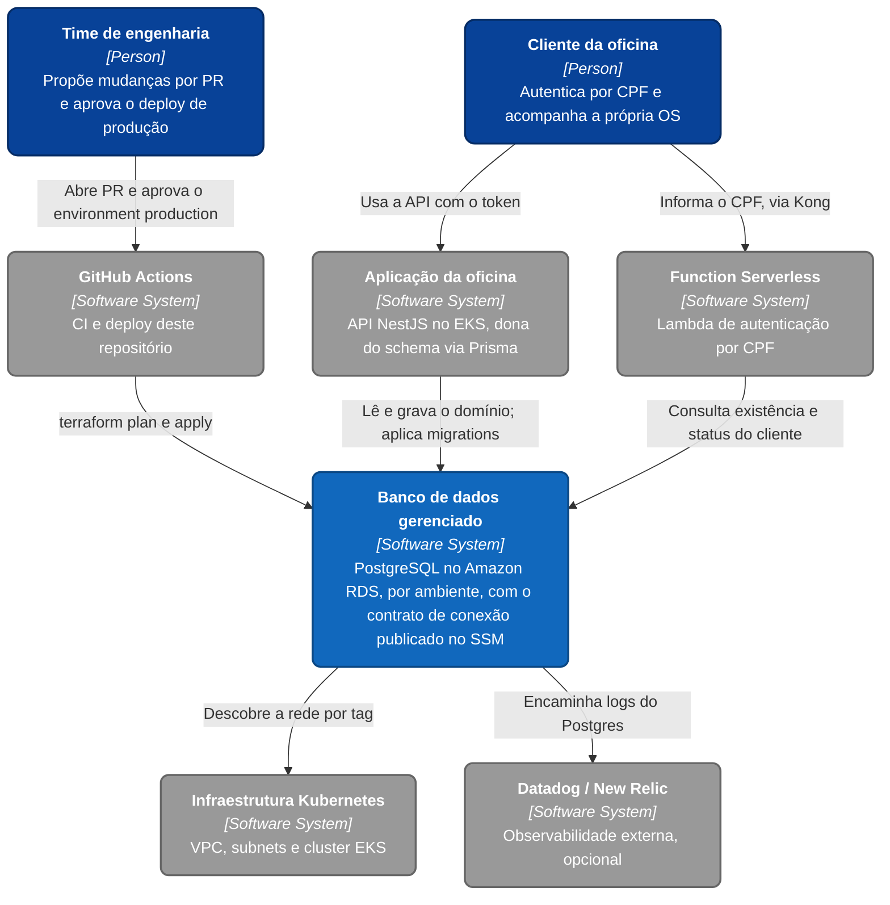
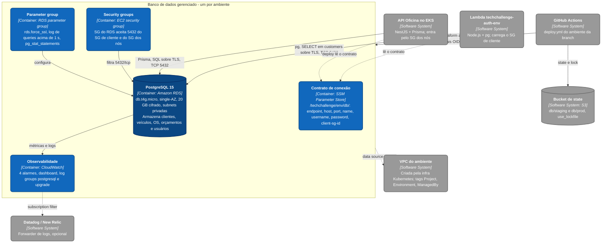
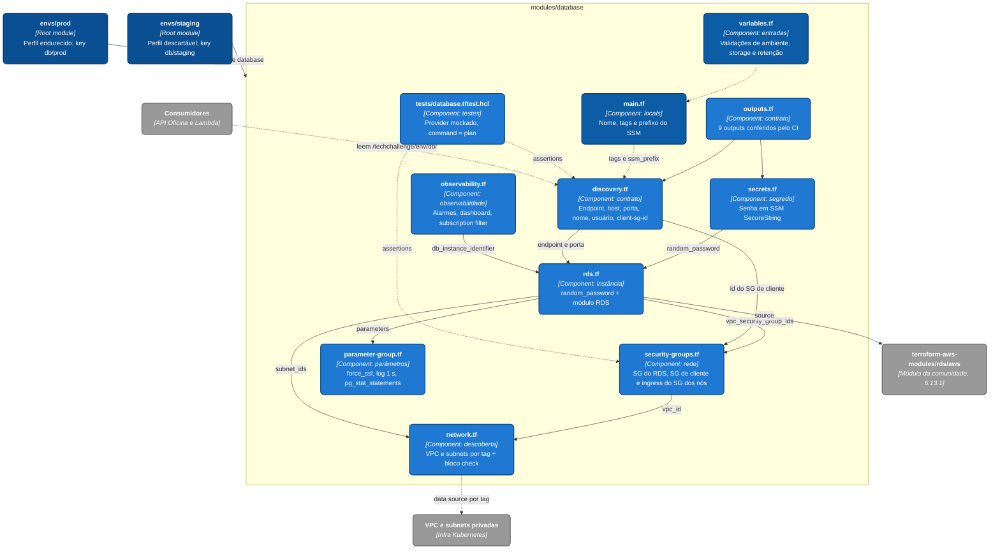

# C4 Model - Banco de Dados Gerenciado

Este documento reúne os diagramas C4 em Mermaid para visualização direta no GitHub. O
sistema em foco é o **banco de dados gerenciado** que este repositório provisiona; a
aplicação, a Function Serverless e a infraestrutura Kubernetes aparecem como sistemas
externos, e os diagramas C4 de cada um vivem no repositório deles.

Arquivos-fonte:

- [context.mmd](context.mmd)
- [container.mmd](container.mmd)
- [components.mmd](components.mmd)

## Nível 1 - Contexto

Quem usa o banco e de quem ele depende. O banco não tem usuário humano direto: o time de
engenharia o altera só por Pull Request e pipeline, e o cliente da oficina chega a ele
indiretamente, pela Lambda e pela aplicação.

## Nível 2 - Container

O que existe dentro da conta AWS, por ambiente. "Container" aqui é unidade implantável no
sentido do C4 — instância RDS, parameter group, security groups, parâmetros do SSM e
recursos do CloudWatch —, e não container Docker. Este repositório não gera imagem.

## Nível 3 - Components

Como o módulo `modules/database` se divide em arquivos, e qual depende de qual. Os dois
root modules (`envs/staging` e `envs/prod`) chamam o mesmo módulo com perfis diferentes —
ver [ADR-003](../ADRs/ADR-003-um-state-por-ambiente.md).

