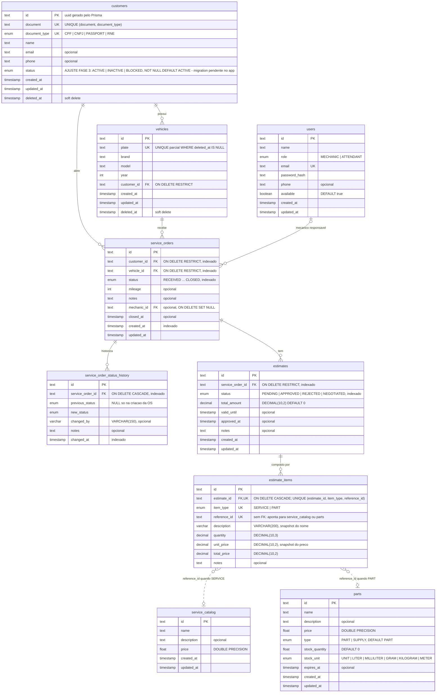

# Modelagem de dados

Este documento descreve o modelo relacional que roda no PostgreSQL gerenciado provisionado
por este repositório: as nove tabelas, as cardinalidades, o porquê de cada relacionamento e
de cada índice, e o ajuste de modelo que a Fase 3 exige — a coluna `status` em `customers`.

A justificativa formal da escolha do banco está na
[RFC-001](RFCs/RFC-001-escolha-do-banco-gerenciado.md) e no
[ADR-001](ADRs/ADR-001-rds-postgresql-gerenciado.md). Aqui o assunto é o **modelo**.

## Quem é dono de quê

| O quê | Dono | Onde |
|---|---|---|
| Instância, rede, parâmetros, contrato de conexão | **Este repositório** | `modules/database` |
| Tabelas, colunas, índices, enums | Repositório da aplicação ([tech-challenge-app-](https://github.com/DevKaue/tech-challenge-app-)) | `prisma/schema.prisma` e `prisma/migrations/` |
| Leitura de `customers` para autenticar por CPF | Repositório da Lambda ([TechChallange---Function-Serverless](https://github.com/DevKaue/TechChallange---Function-Serverless)) | `src/infra/repositories/pg-customer.repository.ts` |

A divisão é deliberada. O RDS nasce **vazio**: as tabelas só existem depois do
`prisma migrate deploy` da aplicação. Manter o schema em um único lugar — as migrations do
Prisma — evita a situação em que o Terraform e o ORM disputam a mesma tabela e cada `apply`
desfaz o que o outro fez. Este repositório documenta e justifica o modelo, mas **não o
aplica**.

**Fonte de verdade deste documento:** `prisma/schema.prisma` e `prisma/migrations/` no
branch `develop` do repositório da aplicação. Todo nome de tabela, coluna e índice abaixo
é o nome físico no Postgres (o `@map`/`@@map` do Prisma), e não o nome do model.

| Model do Prisma | Tabela no Postgres |
|---|---|
| `Customer` | `customers` |
| `Vehicle` | `vehicles` |
| `User` | `users` |
| `ServiceCatalog` | `service_catalog` |
| `Material` | `parts` |
| `ServiceOrder` | `service_orders` |
| `ServiceOrderStatusHistory` | `service_order_status_history` |
| `Estimate` | `estimates` |
| `EstimateItem` | `estimate_items` |

> `Material` é mapeado para `parts` por herança das Fases 1 e 2: a tabela nasceu só com
> peças e passou a guardar também insumos (`type = SUPPLY`) na migration
> `20260624000000_materials_include_supplies`, sem renomear a tabela.

---

## Diagrama ER

Fonte: [diagrams/02-modelo-dados.mmd](diagrams/02-modelo-dados.mmd).

Linha cheia é chave estrangeira real no banco. Linha tracejada é referência **lógica**,
sem FK — ver [estimate_items → service_catalog / parts](#estimate_items--service_catalog--parts-referência-polimórfica-sem-fk).



### Convenções que valem para todas as tabelas

- **Chave primária `id TEXT` com UUID.** O `@default(uuid())` do Prisma gera o valor **no
  cliente**, não no banco: a coluna é `TEXT` e não há `DEFAULT` no SQL. Consequência
  prática: um `INSERT` manual, fora do Prisma, precisa informar o `id`.
- **`created_at` / `updated_at` em `TIMESTAMP(3)`**, sem fuso. O `created_at` tem
  `DEFAULT CURRENT_TIMESTAMP` no banco; o `updated_at` é preenchido pelo Prisma
  (`@updatedAt`), não por trigger.
- **Enums nativos do Postgres** (`CREATE TYPE ... AS ENUM`), gerados pelo Prisma. Um valor
  fora da lista é recusado pelo próprio banco, antes de chegar à aplicação.
- **`ON UPDATE CASCADE` em todas as FKs**, padrão do Prisma. Na prática não tem efeito,
  porque nenhuma chave primária é alterada depois de criada.
- **Soft delete por `deleted_at`** em `customers` e `vehicles`, as duas entidades que o
  negócio arquiva em vez de apagar.

---

## Relacionamentos

As cardinalidades seguem a notação do diagrama: `||` exatamente um, `|o` zero ou um,
`o{` zero ou muitos.

### customers 1 — N vehicles

Um cliente possui **zero ou muitos** veículos; todo veículo pertence a **exatamente um**
cliente (`vehicles.customer_id NOT NULL`). A FK é `ON DELETE RESTRICT`: o banco recusa
apagar um cliente que ainda tenha veículo. Isso é coerente com o soft delete — o fluxo
normal arquiva o cliente (`deleted_at`) e nunca chega a emitir `DELETE`; o `RESTRICT` é a
rede de segurança para um `DELETE` manual não deixar veículo órfão.

Como `customer_id` é obrigatório e o veículo tem soft delete, a forma de representar uma
troca de dono sem reescrever o histórico é arquivar o registro antigo e criar outro para o
novo dono — caso que só cabe no modelo porque a unicidade da placa é **parcial** (ver
[índices](#vehicles)).

### customers 1 — N service_orders

Um cliente abre **zero ou muitas** ordens de serviço; toda OS tem **exatamente um**
cliente. A OS guarda o `customer_id` **além** do `vehicle_id`, embora o cliente pudesse ser
deduzido pelo veículo. A redundância é intencional: a OS registra **quem trouxe o veículo
naquela data**, e esse fato não pode mudar se o veículo trocar de dono depois. `ON DELETE
RESTRICT`, pelo mesmo motivo do relacionamento anterior: OS é documento operacional e
financeiro, não some por cascata.

> O modelo não impõe que o `customer_id` da OS seja o dono atual do `vehicle_id`. Essa
> regra fica na aplicação. Uma FK composta resolveria no banco, mas impediria justamente o
> caso de OS antiga de veículo que trocou de dono.

### vehicles 1 — N service_orders

Um veículo recebe **zero ou muitas** OS ao longo da vida; toda OS é de **exatamente um**
veículo. `ON DELETE RESTRICT`: apagar fisicamente um veículo com histórico de OS é
recusado.

### users 0..1 — N service_orders (mecânico responsável)

Uma OS tem **zero ou um** mecânico responsável (`mechanic_id` é opcional: a OS nasce na
recepção, antes de alguém assumi-la); um usuário pode ser responsável por **zero ou
muitas** OS. É o único relacionamento com `ON DELETE SET NULL`: se o usuário for removido,
a OS continua existindo e apenas perde o responsável. Apagar a OS junto
(`CASCADE`) destruiria histórico de atendimento; recusar (`RESTRICT`) impediria remover
um funcionário que já atendeu.

### service_orders 1 — N service_order_status_history

Toda transição de status de uma OS gera uma linha de histórico; a OS tem **zero ou
muitas** linhas, e cada linha pertence a **exatamente uma** OS. É uma **composição**: o
histórico não tem significado fora da OS, por isso `ON DELETE CASCADE`. O comentário da
migration descreve a tabela como log imutável de transições; `previous_status` é `NULL`
somente na criação da OS.

O histórico é o que permite medir **tempo médio por status** sem guardar um timestamp por
etapa na própria OS — o par (`new_status`, `changed_at`) consecutivo dá a duração de cada
fase.

### service_orders 1 — N estimates

Uma OS tem **zero ou muitos** orçamentos — o modelo admite mais de um ao longo da
negociação, e o enum prevê `REJECTED` e `NEGOTIATED` —; cada orçamento é de **exatamente
uma** OS. `ON DELETE RESTRICT`, ao
contrário do histórico: orçamento aprovado é registro de um acordo com o cliente e não
pode desaparecer como efeito colateral de outra exclusão.

### estimates 1 — N estimate_items

Um orçamento é **composto por zero ou muitos** itens; cada item pertence a **exatamente
um** orçamento. Composição pura, `ON DELETE CASCADE`: item não existe sem o orçamento.

O item guarda `description` e `unit_price` como **snapshot** do momento em que o orçamento
foi criado (está nos comentários da migration). Se o preço do catálogo mudar amanhã, o
orçamento aprovado ontem continua valendo o que foi aprovado.

### estimate_items → service_catalog / parts (referência polimórfica, sem FK)

`reference_id` aponta para `service_catalog.id` quando `item_type = 'SERVICE'` e para
`parts.id` quando `item_type = 'PART'`. Não há FK porque uma FK do Postgres aponta para
**uma** tabela só. Do ponto de vista do item, a cardinalidade é **exatamente um** alvo, mas
em uma de duas tabelas — por isso o diagrama mostra `o|` (zero ou um) para cada lado e
linha tracejada.

O custo dessa escolha é que o banco **não** garante que o `reference_id` exista. Ele é
aceitável porque o item já carrega o snapshot de nome e preço: mesmo que o serviço ou a
peça sejam removidos do catálogo, o orçamento continua legível e com o valor correto. As
alternativas — duas colunas opcionais (`service_catalog_id`, `part_id`) com um `CHECK` de
exatamente uma preenchida, ou duas tabelas de itens — dariam integridade referencial ao
custo de migrar o schema da aplicação, e ficam registradas como evolução possível, não
como decisão deste repositório.

### service_catalog e parts

São tabelas de **catálogo**, sem FK de saída. Só são referenciadas logicamente por
`estimate_items`.

---

## Índices e restrições de unicidade

Toda chave primária gera um índice único (`<tabela>_pkey`), que não se repete abaixo. A
coluna "Consulta servida" diz qual leitura cada índice existe para atender — é essa
leitura que justifica o custo extra de cada escrita.

### customers

| Índice | Colunas | Tipo | Consulta servida / porquê |
|---|---|---|---|
| `customers_document_document_type_key` | `(document, document_type)` | `UNIQUE` | Impede dois cadastros para o mesmo documento. A unicidade é do **par**: o mesmo número pode existir como tipos diferentes (um passaporte e um RNE não colidem por coincidência de dígitos). É também o índice do **caminho quente da autenticação**: a Lambda consulta `WHERE document = $1 AND document_type = 'CPF'`, igualdade nas duas colunas, que o índice resolve sem varrer a tabela |

A unicidade de `customers` **não** é parcial, diferente da de `vehicles`: um cliente
arquivado continua ocupando o documento. É coerente com o negócio — a mesma pessoa que
volta é **reativada**, não recadastrada — e é o que permite à Lambda distinguir "não
existe" de "existe, mas está arquivado" lendo `deleted_at`.

### vehicles

| Índice | Colunas | Tipo | Consulta servida / porquê |
|---|---|---|---|
| `vehicles_plate_active_unique_idx` | `(plate) WHERE deleted_at IS NULL` | `UNIQUE` parcial | Uma placa só pode estar **ativa** uma vez, mas pode reaparecer depois de o veículo antigo ser arquivado (troca de dono). Um `UNIQUE (plate)` simples impediria esse caso. Substituiu o `vehicles_plate_key` na migration `20260624022932_alter_vehicle_plate_unique_to_partial_index`, e usa o preview feature `partialIndexes` do Prisma — um dos motivos para o banco precisar ser PostgreSQL |

> **Lacuna:** `vehicles.customer_id` é FK **sem índice**. O Postgres não cria índice em FK
> automaticamente, então "listar os veículos de um cliente" varre a tabela. Na escala de
> uma oficina, irrelevante; ver o critério em [Lacunas conhecidas](#lacunas-conhecidas-do-modelo).

### users

| Índice | Colunas | Tipo | Consulta servida / porquê |
|---|---|---|---|
| `users_email_key` | `(email)` | `UNIQUE` | O e-mail é o identificador de login dos usuários internos (atendentes e mecânicos). Unicidade e busca por igualdade no mesmo índice |

### service_orders

| Índice | Colunas | Tipo | Consulta servida / porquê |
|---|---|---|---|
| `idx_service_orders_customer_id` | `(customer_id)` | B-tree | Histórico de OS de um cliente. Também evita varredura quando o `RESTRICT` de `customers` precisa conferir se há OS antes de um `DELETE` |
| `idx_service_orders_vehicle_id` | `(vehicle_id)` | B-tree | Histórico de OS de um veículo; mesmo papel no `RESTRICT` de `vehicles` |
| `idx_service_orders_status` | `(status)` | B-tree | Fila de trabalho por etapa (ex.: OS em `WAITING_APPROVAL`). O enum tem só 7 valores, então o índice só ajuda quando o status filtrado é **seletivo** — as etapas em andamento são poucas perto das `CLOSED`, que é exatamente o caso de uso |
| `idx_service_orders_created_at` | `(created_at)` | B-tree | Listagem ordenada por data e recortes por período (volume diário de OS) |

> **Lacuna:** `mechanic_id` também é FK **sem índice** — ver
> [Lacunas conhecidas](#lacunas-conhecidas-do-modelo).

### service_order_status_history

| Índice | Colunas | Tipo | Consulta servida / porquê |
|---|---|---|---|
| `idx_status_history_service_order_id` | `(service_order_id)` | B-tree | Linha do tempo de uma OS. Também é o que torna barato o `ON DELETE CASCADE` a partir de `service_orders` |
| `idx_status_history_changed_at` | `(changed_at)` | B-tree | Consultas por período sobre transições — base do tempo médio por status |

### estimates

| Índice | Colunas | Tipo | Consulta servida / porquê |
|---|---|---|---|
| `idx_estimates_service_order_id` | `(service_order_id)` | B-tree | Orçamentos de uma OS; e a checagem do `RESTRICT` a partir de `service_orders` |
| `idx_estimates_status` | `(status)` | B-tree | Orçamentos pendentes de aprovação. Mesmo raciocínio de seletividade do status da OS |

### estimate_items

| Índice | Colunas | Tipo | Consulta servida / porquê |
|---|---|---|---|
| `estimate_items_estimate_id_item_type_reference_id_key` | `(estimate_id, item_type, reference_id)` | `UNIQUE` | O mesmo serviço ou a mesma peça aparece **uma vez** por orçamento; quantidade se ajusta em `quantity`, não em linha duplicada. Como `reference_id` não tem FK, esta é a única restrição de integridade sobre ele |
| `idx_estimate_items_estimate_id` | `(estimate_id)` | B-tree | Itens de um orçamento e o `CASCADE` a partir de `estimates`. **Redundante**: o índice único acima começa por `estimate_id` e já atende essa busca |
| `idx_estimate_items_reference_id` | `(reference_id)` | B-tree | Pergunta inversa: em quais orçamentos um serviço ou peça aparece — impacto de mudança de preço ou de falta em estoque |
| `idx_estimate_items_item_type` | `(item_type)` | B-tree | Separar serviços de peças. Com só 2 valores, raramente é escolhido pelo planejador sozinho |

### service_catalog e parts

Só a chave primária. São tabelas pequenas, lidas por `id` (vindo de `reference_id`) ou
listadas inteiras.

---

## Ajuste do modelo relacional na Fase 3: `customers.status`

### O problema

O desafio da Fase 3 pede que a Function Serverless de autenticação consulte **a existência
e o status do cliente** antes de emitir o token. Nas Fases 1 e 2, a tabela `customers` só
tinha um estado: arquivado ou não (`deleted_at`). Isso responde "existe e não foi
apagado", mas não responde "está apto a usar o sistema" — não há como bloquear um cliente
sem apagá-lo.

### O ajuste

```sql
CREATE TYPE "CustomerStatus" AS ENUM ('ACTIVE', 'INACTIVE', 'BLOCKED');

ALTER TABLE "customers"
  ADD COLUMN "status" "CustomerStatus" NOT NULL DEFAULT 'ACTIVE';
```

No `schema.prisma`, o equivalente é o enum `CustomerStatus` e o campo
`status CustomerStatus @default(ACTIVE) @map("status")` no model `Customer`.

| Decisão | Por quê |
|---|---|
| **Enum**, não booleano `is_active` | Um booleano não distingue `INACTIVE` (o cliente deixou de usar) de `BLOCKED` (a oficina impediu o acesso). São motivos diferentes, com tratamento operacional diferente |
| **Enum nativo**, não `TEXT` com `CHECK` | É o que o Prisma gera e o que o resto do schema já usa (`ServiceOrderStatus`, `EstimateStatus`...). Valor desconhecido é recusado pelo banco |
| **`NOT NULL DEFAULT 'ACTIVE'`** | Preenche as linhas existentes no mesmo comando: todo cliente cadastrado antes do ajuste continua podendo autenticar. No PostgreSQL 11+ um `ADD COLUMN` com default constante não reescreve a tabela, então a migration é instantânea mesmo com dados |
| **Convive com `deleted_at`**, não o substitui | Arquivar continua sendo exclusão lógica; `status` descreve o ciclo de vida de quem **não** foi arquivado. Trocar o soft delete por um quarto valor do enum (`DELETED`) obrigaria reescrever todas as consultas da aplicação que já filtram por `deleted_at` |
| **Sem índice em `status`** | A Lambda localiza o cliente pelo índice único de documento e só **lê** o `status` da linha encontrada. Um índice em 3 valores não serviria a nenhuma consulta existente |

### Contrato com a Lambda

A Lambda executa exatamente esta consulta, projetando só o necessário — sem nome, e-mail
ou telefone:

```sql
SELECT id, status, deleted_at
  FROM customers
 WHERE document = $1
   AND document_type = 'CPF'
 LIMIT 1;
```

E considera o cliente **elegível** só quando `deleted_at IS NULL` **e**
`status = 'ACTIVE'`. Os valores do enum são contrato entre os dois repositórios: um valor
novo no banco que a Lambda não conheça é tratado como drift e vira **503**, nunca token
emitido.

### Situação: migration pendente no repositório da aplicação

> **A migration deste ajuste ainda não está no `develop` da aplicação.** Ela foi escrita
> (`20261009230000_add_status_to_customers`, com a mudança correspondente no
> `schema.prisma`) em um PR que foi fechado sem merge, e o `schema.prisma` do `develop`
> **não tem** a coluna `status`.

O dono do ajuste é o repositório da aplicação, porque é lá que vivem as migrations do
Prisma; este repositório não cria tabela nem coluna (ver [Quem é dono de quê](#quem-é-dono-de-quê)).
Enquanto a migration não entrar no `develop` e não for aplicada pelo `prisma migrate
deploy`:

- a consulta da Lambda falha com `column "status" does not exist`, que ela trata como
  indisponibilidade da base e responde **503** para qualquer CPF;
- o diagrama ER acima mostra a coluna porque ele descreve o modelo **exigido** pela Fase 3,
  e a marca como pendente.

Esse item está nas [dívidas conscientes do README](../README.md#dívidas-conscientes),
com o critério que o torna inaceitável.

---

## Lacunas conhecidas do modelo

São observações sobre o schema da aplicação, registradas aqui porque este repositório é
quem opera o banco e enxerga o efeito delas. A correção é migration no repositório da
aplicação.

| Lacuna | Efeito | Quando passa a ser inaceitável |
|---|---|---|
| `vehicles.customer_id` e `service_orders.mechanic_id` são FKs **sem índice** | Listar veículos de um cliente ou OS de um mecânico varre a tabela; o `RESTRICT`/`SET NULL` também | Quando essas consultas aparecerem no log de queries lentas (`log_min_duration_statement = 1000`, ver `parameter-group.tf`) |
| `idx_estimate_items_estimate_id` é redundante com o índice único composto | Custo de escrita e de armazenamento sem ganho de leitura | Ao revisar índices não usados em `pg_stat_user_indexes`, com `pg_stat_statements` habilitado |
| `service_catalog.price` e `parts.price` são `DOUBLE PRECISION` | Valor monetário em ponto flutuante acumula erro de arredondamento. O efeito é contido porque o orçamento copia o preço para `DECIMAL(10,2)` | Quando algum cálculo financeiro passar a ler o preço do catálogo direto, sem passar pelo snapshot do orçamento |
| `estimate_items.reference_id` sem FK | O banco não garante que o serviço/peça exista | Quando o item precisar ser resolvido para o catálogo atual, e não só exibido pelo snapshot |
